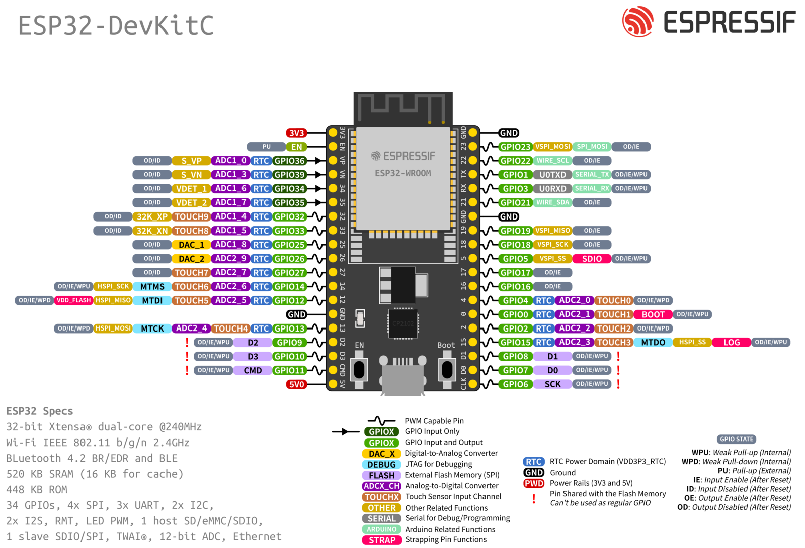
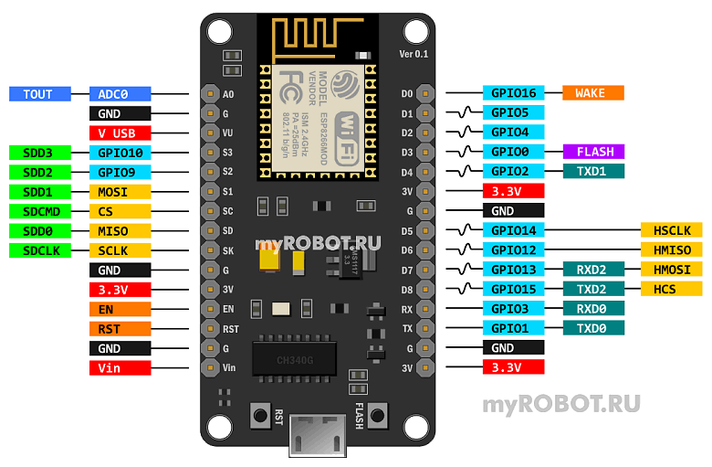
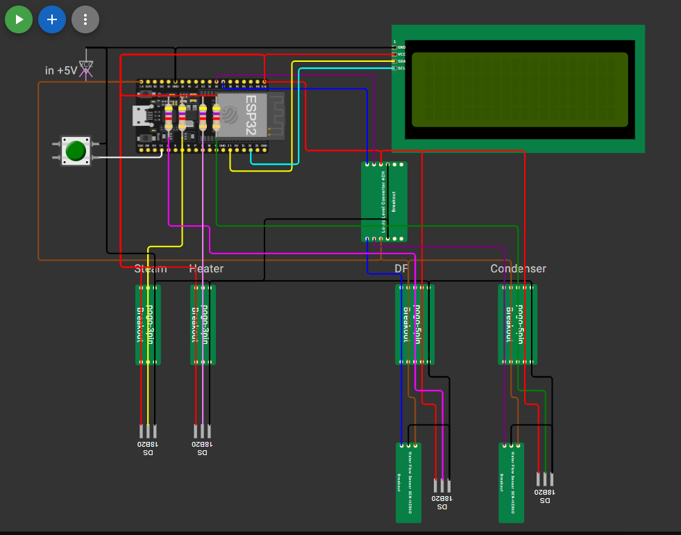
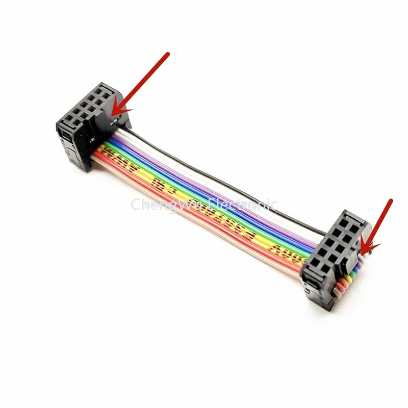

# Moonshine
Temperature and water flow control

## Оборудование
- Датчики температуры DS18B20
    - (Tank) Температура внутри бака D8 с резьбой 1/2" 
    - (WaterOut) 2x Трехпроводные датчики для измерения температуры воды на выходе
        - df-out, °C
        - condenser-out, °C
    - 
- Датчики Холла для измерения потока воды (расход в мл/мин по импульсам за последние 10 с, калибровка датчика кнопкой)
    - из дефлегматора (df)
    - из охладителя (condenser)
- ESP32-WROOM-32 Pinout <br>
- NodeMCU v3 Pinout — плата не используется, снимок в архиве <br>


## Названия переменных
- t_steam — Температура паров в верху колонны (после дефлегматора). Ключевая точка для контроля фракций.
- t_heater — Температура в нагревательном баке (кубе) с исходным материалом.
- t_deflegmator_water_out — Температура воды на выходе из дефлегматора. Показывает эффективность дефлегматора.
- t_condenser_water_out — Температура воды на выходе из охладителя (конденсатора/холодильника). Показывает эффективность конечного охлаждения.
- flow_deflegmator_water — Скорость потока воды через дефлегматор.
- flow_condenser_water — Скорость потока воды через охладитель (конденсатора/холодильника).

## Архитектура проекта
 
Основные компоненты:
ESP32-WROOM-32 (38pin) - взял с запасом, чтобы можно было подклчюить и графический дисплей, но потом оставил так

4 датчика температуры DS18B20 (водонепроницаемые, с цифровым интерфейсом OneWire). Один провод для всех датчиков + питание + земля.

Resistor 4.7kΩ между сигнальным проводом и питанием для подтяжки линии OneWire.

- D4 GPIO04 t_steam
- D5 GPIO05 t_heater
- D18 GPIO18 t_deflegmator_water_out
- D19 GPIO19 t_condenser_water_out

Примечание: не хочется возиться с адресами датчиков и их индексаций, буду подуключать датчики по одному на каждый пин и опрашивать отдельно, чтобы можно спокойно заменять датчики и точно знать, где какой

Для каждого датчика линию данных подтягиваем через 4.7kΩ Resistor к +3.3V
Все датчики на разных входах, чтобы можно было подключать любой датчик без настройки адресов 

### Датчик расхода воды

YF-S201 Не не подошел, слишком грубый.

Был подбран датчик для кофемашин с малыми потоками.
* Water Flow Sensor SEN-HZ06D

// ПРАВИЛЬНО - используем INPUT без дополнительной подтяжки
pinMode(FLOW_SENSOR_PIN, INPUT);  

Адаптация уровней напряжения:
SEN-HZ06D выдает 5V импульсы, а ESP32 работает с 3.3V логикой.
Используем 4-канальый конвертор логических уровней 5V-3V3

### 🔌 Сигнальные пины (GPIO) ESP32

| Пин на ESP32 | GPIO № | Куда идет (Компонент -> Пин) | Назначение / Примечание |
| :--- | :--- | :--- | :--- |
| **D21** | 21 | LCD2004 (`SDA`) | Шина I2C (данные) |
| **D22** | 22 | LCD2004 (`SCL`) | Шина I2C (тактирование) |
| **D15** | 15 | Кнопка (`1.l`) | Вход кнопки. В коде обязательно включить `INPUT_PULLUP` |
| **D4** | 4 | Датчик Steam (`DQ`) | Шина 1-Wire (пар) |
| **D5** | 5 | Датчик Heater (`DQ`) | Шина 1-Wire (нагреватель) |
| **D18** | 18 | Датчик DF (`DQ`) | Шина 1-Wire (дефлегматор) |
| **D19** | 19 | Датчик Cond (`DQ`) | Шина 1-Wire (конденсатор/холодильник) |
| **D32** | 32 | Преобразователь (`LV1`) | Сигнал от датчика потока `flowDF` (после понижения уровня) |
| **D33** | 33 | Преобразователь (`LV2`) | Сигнал от датчика потока `flowCond` (после понижения уровня) |

#### Схема коммутации

- ESP32-WROOM-32 Scheme <br>

### Распиновка контактов

#### 3-pin датчик с сигнальным
Рекомендованная разводка:

text
Разъем XH-2.54 3-pin (вид на плату):
       ┌─────┐
       │  ●  │ 1: GND      (Черный провод)
       │  ●  │ 2: 3V3      (Красный провод)  
       │  ●  │ 3: DATA     (Желтый провод)
       └─────┘
       
На плате (рядом с разъемом):
[GND] [3V3] [DATA]  ← шелкография
На принципиальной схеме:

text
Разъем J1 (DS18B20):
Pin 1: GND
Pin 2: 3V3
Pin 3: TEMP_DATA
5. Как определить правильную ориентацию:
Ключ (polarity key) на разъеме:
text
           ┌─────────┐
           │  КЛЮЧ   │ ← Выступ/защелка
           │   ▼     │
Контакты → │ ●  ●  ● │
           └─────────┘
           
Ключ всегда направлен:
- К началу (пину 1 - GND) ИЛИ
- К концу (пину 3 - DATA)
Распространенное правило: Ключ направлен к пину 1 (GND)

#### Комбирированный pogo 5-pin магнитный разъем для подключения датчика температуры и потока воды (дефлегматор и конденсер)
Магнитный раъъем на корпусе контроллера, снизу разделяется на два 3-pin водозащитных разъема.

Рекомендуемая распиновка для 5-pin магнитного разъема

Вид на разъем (на плате/в схеме):
Позиция датчиков в линии: [Датчик темп.]---[Датчик потока]
                          (ближе к плате)   (дальше)

##### РАЗЪЕМ 5-PIN:
┌─────┬─────┬─────┬─────┬─────┐
│  1  │  2  │  3  │  4  │  5  │
├─────┼─────┼─────┼─────┼─────┤
│ GND │ 3V3 │TEMP │ VCC │FLOW │
│     │     │DATA │(5V) │DATA │
└─────┴─────┴─────┴─────┴─────┘
     ↑     ↑     ↑     ↑     ↑
Общий   Для   Для     Для   Для
GND   DS18B20 DS18B20 Потока Потока

##### Обоснование:
- GND (пин 1) - общая земля для обоих датчиков
- 3V3 (пин 2) - питание температурного датчика DS18B20
- TEMP_DATA (пин 3) - данные температурного датчика
- VCC (пин 4) - питание 5V для датчика потока
- FLOW_DATA (пин 5) - данные датчика потока

##### На плате (PCB Layout):
- Метки шелкографии:
┌─────────────────────┐
│ DEFLEG/COND LINE    │
│  MAGNETIC CONNECTOR │
│                     │
│  1: GND  ⚫         │
│  2: 3V3  🔴         │
│  3: TEMP 🟡         │
│  4: 5V   🟤         │
│  5: FLOW 🔵         │
│                     │
│   ▲ KEY/MAGNET      │
└─────────────────────┘
- Цветовая маркировка проводов в кабеле:

##### Рекомендуемая цветовая схема:
┌─────┬───────┬──────────────┐
│ Пин │ Цвет  │ Назначение   │
├─────┼───────┼──────────────┤
│  1  │Черный │ GND (общий)  │
│  2  │Красный│ 3V3 (темп.)  │
│  3  │Желтый │ TEMP_DATA    │
│  4  │Коричневый│ 5V (поток) │
│  5  │Синий  │ FLOW_DATA    │
└─────┴───────┴──────────────┘


Преимущества:
Логическая группировка - сначала всё для температуры, потом для потока
Безопасность - GND первым, сигналы разделены питанием
Удобство отладки - цвета соответствуют функциям
Защита от ошибок - магнитный разъем + правильная полярность
На плате подпишите:

DEFLEG/COND LINE
[G] [3V] [T] [5V] [F]
▲ магнит/ключ

##### Защита и фильтрация:
На стороне платы (рядом с разъемом):

Добавьте:
- Конденсатор 100nF между 3V3 и GND (для DS18B20)
- Конденсатор 100nF между 5V и GND (для датчика потока)
- Резистор 4.7kΩ: TEMP_DATA → 3V3 (подтяжка OneWire)
- Резистор 10kΩ: FLOW_DATA → 3.3V (подтяжка на стороне ESP)
- Диод 1N4007 на линии 5V (защита от обратной полярности)

На стороне линии (в разветвителе):
В разветвителе добавьте:
- Еще по 100nF конденсатору у каждого датчика
- TVS диод на линии DATA (защита от статики)

## Links
### GyverDS18
https://github.com/GyverLibs/GyverDS18
### Принципиальная схема подключения DS18B20 к ESP8266
https://microkontroller.ru/esp8266-projects/podklyuchenie-datchika-temperatury-ds18b20-k-esp8266/

### Controlling Steam Valve with Arduino and Stepper Motor
https://arduinoexpert.com/controlling-steam-valve-with-arduino-and-stepper-motor/
- ➤ Stepper Motor to DRV8825
- ➤ DRV8825  
- ➤ 12V Power Supply:

### Размеры элементов на монтажной плате с шагом 2.54

- Монтажная плата основная      24x18
- ESP8266 NodeMCU               15x11
- BTN                           6x3
- 10pin cable                   5x2 (+1 во все стороны корпус)
- Конвертор логических уровней 4канала  6x5
- Монтажная плата для датчиков  28x6

### Version
#### 0.0.1
Добавил основу проекта, настроил библиотеки
#### 0.0.2
sensor_t - обвязка вокруг GyverDS18 для опроса датчиков температуры
#### 0.0.3
Исправил опрос температуры, датчики можно переключать на ходу
#### 0.0.4
Подключил LCD 2004 для вывода температуры и времени работы
Добавил медианный (median3) фильтр для сглаживания температуры и вывожу только 1 знак после запятой.
#### 0.0.5
Изменил пины подключения, допаял колодку подключения;
Пока не работает делить для 5В датчика потока - отключил;
Добавил на S3 сенсорную кнопку для отладки.
Небольшая оптимизация кода и вывода на экран.

#### 0.0.6-0.0.10
- Изменил пины, подобрал все входы. чтобы работали датчики. кнопка запуска калибровки датчиков расхода воды. и не мешало запуску и работе ESP8266&.
- Убрал делители напряжения и поставил 4 канальный согласователь логических уровней 3.3V-5V. Теперь датчик холла нормально работает на 5В и не превышает допустимые уровни.
- Собрал первую рабочую схему с полным набором датчиков в конфигурации:
    - S: температура в верхней части колонны (главный контроль отбора фракций)
    - D: температура и счетчик потока воды на выходе из дефлегматоре (больше для контроля и калибровки модифицированнго YF-S201 датчика). В среднем расход 2 мин/1 л (~30L/min). Можно заменить на YF-S401 - его чувствительности должно хватать без модификаций
    - C: температура и счетчик потока воды на выходе из кондесера. Датчик YF-S401 часто простаивает из-за малого потока (13 мин / 1 л, ~5L/min). Нужен более чувствительный датчик.
    - H: температура в нагревательном баке (контроль мощности плиты)
- Сделал режим калибровки. При нажатии на кнопку оба датчика расхода воды сбрасываются и начинают считать время и количество пульсов датчика Холла. Второе нажатие отключает калибровку и покахывает итоговые результаты. Они нужны для составления таблицы и дальнейшего расчета потока воды на разных скоростях потока воды, чтобы учесть неравномерность работы датчика на малых расходах и индивидуальные особенности конкретного датчика.
- Вся схема собрана на макетной плате и бредборде на перемычках. Продумать реализацию автоматической регулировки игольчатого крана с помощью шагового двигателя. После отладки автоматизации развести плату для чистовой пайки и напечатать модель корпуса.
- Перекоммутировал трубки для воды и расположение игольчатых кранов. чтобы локализовать все в одном месте рядом с расбором воды и освободить место для датчиков.
- Выполнил первую дистиляцию с электронным контролем температуры без аналоговых датчиков;

#### 1.0.x
- Изменил заглавную "C" на строчную "c", чтобы не отвлекало от значений.
- Уменьшил скорость индикатора потока на порядок для более плавной анимации. Возможно, нужно будет еще сделать меньше.
- Купил более чувствительные датчики потока "SEN-HZ06D DC5V Small Size Mini Water Flow Sensor Fluid Flow Meter Switch 0.05-1.5L/min For Coffee Machine", буду добавлять в макет
https://ali.click/ktwszq
<br>
- С помощью qwen 3.5 сделал макет Web-UI для показа текущего состояния [qwen-distillation](docs/hystory/qwen-distillation.045.html)
- Сделал первый макет разводки PCB платы в EasyEDA. Вместо датчика температуры 3pin и датчика потока 3pin принял решение делать комбинированный pogo 5pin разъем.
- для соединения основной платы и контактной панели с разъемами для датчиков планирую использовать двойной 10pin шлейф <br>

#### 1.0.31 Добавил макет web-ui с помощью qwen 3.5

#### 1.1.1 settings::moonshine::state_t
Начал оборачивать все данные в нормальные структуры...

#### 1.2.0 Web UI для ESP8266
Добавлен веб-интерфейс для мониторинга процесса дистилляции:
- **Платформа:** ESP8266 (NodeMCU v3)
- **Режимы работы:**
  - Точка доступа (AP): `Moonshine_AP` / `moonshine123`
  - Подключение к Wi-Fi сети (STA)
  - Комбинированный режим (STA+AP)
- **mDNS:** http://moonshine.local (при подключении к Wi-Fi)
- **Обновление данных:** 500ms через AJAX
- **Файлы:**
  - `src/web-ui.h` — объявление веб-сервера
  - `src/web-ui.cpp` — реализация сервера с HTML шаблоном
  - `docs/hystory/main_ui.cpp.md` — пример инициализации
- **API:**
  - `GET /` — HTML страница мониторинга
  - `GET /api/state` — JSON с текущими показаниями датчиков
  - `GET /api/status` — JSON со статусом системы (uptime, режим, IP)
- **Данные:** Используются из `settings::moonshine::state_t`
- **Версия веб-интерфейса:** Синхронизирована с `MS_VERSION_STRING` из `version.h`

##### Использование:
```cpp
#include "web-ui.h"

settings::moonshine::state_t get_state(); // Ваша функция получения данных

webui::MoonshineWebServer webServer;

void setup() {
    webServer.setStateGetter(get_state);
    webServer.begin();
}

void loop() {
    webServer.handleClient();
}
```

#### 1.2.3 Исправление mDNS
Исправлена работа mDNS для доступа по http://moonshine.local:
- Добавлен вызов `MDNS.update()` в цикле обработки клиентов
- Исправлен порядок инициализации WiFi (hostname до mode)
- Без этого mDNS служба не отвечала на запросы после запуска

#### 1.3.0 Переход на ESP32-WROOM

- Заменил чип, чтобы было больше разъемов и можно было подключить графический экран потом с энкодером
- Сделал схему в wokwi https://wokwi.com/projects/478560883984119809
- Схема подключения: 
    - docs/wokwi/wokwi-Moonshine_02.zip
    - docs/wokwi/wire-esp32-v2.png

#### 1.3.1 Переход на ESP32-WROOM - fixes

web-ui - updated to ESP32/ESP8266 compatibility

#### 1.3.- Поменял схему подключения ESP32-WROOM и файл readme.md

На память - информация о подключении графического дисплея
docs/ST7789 320x240 EC11 Rotary Encoder Button.md

#### 1.3.3 GyverLCD_UTF8 20x4, etl::vector в wifi-setup, ESP32 на Arduino core 3.x

- Экран переведён на `GyverLCD_UTF8`, раскладка 20x4 (на 16x2 вывод четырёх датчиков не помещается — строки клампятся в две).
- Веб-интерфейс пока отключён (`use_web_ui = false`) — идёт отладка перехода на GyverLCD.
- `etl::wifi::server_setup`: `std::vector` заменён на `etl::vector` из `etl/etl_vector.h`, сортировка сетей по RSSI — вставками, без STL.
- `start_wifi_server()`: режим и IP печатаются из `wifi_server`, а не из обнулённого `web_server`.
- `flow_sensor_t::tick()`: чтение и обнуление `pulse_count` перенесено в критическую секцию (`noInterrupts`), убран двойной `reset()` в `init()`.
- ESP32: платформа `espressif32` 8.x (Arduino core 3.x) — ETL 1.1.2 использует `ledcAttach`/`ledcDetach` из ядра 3.x.
- Сборка: ESP8266 — RAM 39.6%, Flash 43.5%; ESP32 — RAM 15.7%, Flash 85.4% (штатная схема разделов).

#### 1.3.4 Своя таблица разделов ESP32 (3 МБ под прошивку), исправлены форматы printf

- Добавлена таблица разделов `partitions/esp32wroom32u_spiffs.csv` для ESP32-WROOM-32U (4 МБ flash), подключена через `board_build.partitions`.
- OTA не планируется, поэтому второй слот приложения и `otadata` убраны: одно приложение `factory` на 3 МБ + LittleFS 960 КБ. Всего ровно 4 МБ.
- Прежний вариант таблицы был расписан на 8 МБ (LittleFS 0x450000 уходила за 0x400000) и давал предупреждение генератора про имя раздела `littlefs` при подтипе `spiffs`.
- Раздел файловой системы назван `spiffs` — так его находит дефолтный `LittleFS.begin()`.
- ESP32: Flash 35.6% (1119352 из 3145728), RAM 15.7%. ESP8266 без изменений: Flash 43.5%, RAM 39.6%.
- Исправлены форматы `printf` для ESP32, где `uint32_t`/`int32_t` — это `long`: `settings.h`, `etl_wifi_setup.h`, `etl_wifi_setup.cpp` (`%lu`/`%ld` с явным приведением).
- `flow_sensor_t::pulse()`: `pulse_count++` заменён на `pulse_count = pulse_count + 1` — инкремент `volatile` запрещён в C++20.

> **Важно: перед заливкой прошивки с новой таблицей разделов очистите flash.**
> Раскладка поменялась, старые разделы останутся в чипе и дадут мусор. Данные LittleFS при этом теряются.
> ```powershell
> pio run -e esp32-wroom-38u -t erase      # очистка флеша (данные LittleFS пропадут)
> pio run -e esp32-wroom-38u -t upload
> ```

#### 1.4.0 Веб-интерфейс на базовых классах ETL: сервер контента и сервер настроек

- `webui::moonshine_web_server` теперь наследует `etl::webui::web_server_base_t`: Wi-Fi, mDNS, загрузка настроек, `tick()` и остановка берутся из библиотеки.
- Добавлен `webui::moonshine_web_manager` (`etl::webui::web_manager`) — переключает сервер контента и сервер настроек. В обычном режиме работает web-ui, а сервер настроек (`etl::webui::server_setup`) поднимается только по запросу: сеть, тема и шрифт настраиваются редко, держать память под них постоянно незачем.
- Настройки Wi-Fi хранятся через `etl::webui::settings::init_wifi_config` / `load_wifi_config`.
- Удалены локальные `src/etl_wifi_setup.h`, `src/etl_wifi_setup.cpp`, `src/etl_wifi_setup_html.h` — 1817 строк, заменены библиотечными.
- Исправлено падение `assert failed: multi_heap_free` при старте: структура со `String` больше не сохраняется в файл сырыми байтами.
- Переключение серверов выполняется из `loop()` после ответа клиенту, а не внутри HTTP-обработчика, где сервер уничтожался на своём же стеке.
- Вход в настройки: кнопка ⚙ на странице, три клика аппаратной кнопкой, удержание кнопки при старте.
- Формат `/settings/wifi.cfg` изменился — после прошивки сеть нужно настроить заново.

#### 1.5.0 Только ESP32 WROOM-38U, чистка pinout.h, архив документов

- Оставлено одно окружение `esp32-wroom-38u`, окружение `nodemcuv3` (espressif8266) удалено: плата ESP8266 вышла из строя, возврат к ней не планируется.
- `src/pinout.h` сокращён с 73 до 29 строк: убраны ветка ESP8266, макросы `BOARD_*`, неиспользуемый `version.h` и `#error` для неизвестной платформы. Фактические GPIO не менялись.
- Из интерфейса убрана кнопка «B»: режим жирных цифр переносится в настройки (`ui_config.use_bold_values`).
- Устаревшие ТЗ, журнал изменений и макеты перенесены в `docs/hystory` (через `git mv`), добавлен указатель `docs/hystory/README.md`.
- `AGENTS.md` и этот файл переведены на ESP32 WROOM-38U.
- Сборка: RAM 15.7% (51416 из 327680), Flash 37.9% (1192244 из 3145728).

#### 1.5.1 Исправлен переход с web-ui на сервер настроек

- WiFi-менеджер ETL теперь один на всё время работы. Раньше каждый сервер создавал свой, и при переключении деструктор старого сервера вызывал `manager::stop()` → `WiFi.mode(WIFI_OFF)`: точка доступа, которую только что поднял сервер настроек, гасла сразу после старта (в логе — `Mode: OFF`, `IP 0.0.0.0`, сеть не видна в списке).
- Страница перехода на настройки больше не делает один редирект: она опрашивает `/`, пока новый сервер не ответит, — точка доступа при переключении перезапускается, клиенту нужно время на переподключение.
- Убрана повторная регистрация mDNS-сервиса `http`: его добавляет WiFi-менеджер, из-за дубля в лог писалась ошибка `Service already exists`.

#### 1.5.2 Переключение на настройки без перезапуска точки доступа

- Сервер контента и сервер настроек создаются один раз при старте и живут всё время работы; при переключении меняется только HTTP-сервер (`stop_http_only()` / `start_http_only()`).
- Wi-Fi при переключении больше не трогается: `web_server_base_t::stop()` с `WiFi.mode(WIFI_OFF)` не используется. Точка доступа `Moonshine_AP` остаётся в списке сетей, клиент не теряет соединение — рвётся только TCP-подключение к 80-му порту. Раньше ESP32 не успевал поднять AP сразу после выключения радио: `WiFi.softAP()` возвращал ошибку, но менеджер ETL не проверяет код возврата и всё равно печатал `AP started, IP: 192.168.4.1`.
- Добавлен `moonshine_settings_server` — наследник `etl::webui::server_setup` с раздельным управлением HTTP-частью.
- Страница перехода опрашивает `/` каждую секунду, а не с задержкой 4 с.

#### 1.5.3 Однозначный лог активного сервера, переход в настройки без гонки

- `moonshine_web_manager::trace_active_server()` печатает реальный тип сервера. Прежний `trace_connection()` из ETL определяет тип по режиму Wi-Fi и в AP называет сервер контента «Setup», что путало при разборе логов.
- Страница перехода опрашивает `/api/config`, который есть только у сервера настроек: старый сервер контента больше не может перехватить опрос и вернуть пользователя на дашборд вместо страницы настроек.

#### 1.5.4 Подробный лог переключения серверов (диагностика)

- `activate_settings()` / `activate_content()` печатают каждый шаг: остановка HTTP, загрузка настроек, запуск HTTP.
- `stop_http_only()` / `start_http_only()` печатают занятую память до и после создания HTTP-сервера.
- Пауза между закрытием и открытием порта увеличена до 100 мс.

#### 1.5.5 Проверка реального запуска точки доступа

- `etl::wifi::manager::start_ap()` не проверяет результат `WiFi.softAP()` и всегда печатает `AP started, IP: 192.168.4.1`, поэтому по логу нельзя понять, поднялась ли сеть. Теперь после инициализации Wi-Fi точка доступа поднимается ещё раз, а в лог пишется настоящий код возврата `softAP()`, режим Wi-Fi, IP и MAC.

#### 1.5.6 Упрощённая иконка устройства вшита в прошивку

- `docs/images/icon_moonshine_mini.svg` перерисован в вектор: 1.5 КБ вместо вшитого PNG на 13 КБ. Колба с чипом и жидкостью, термометр, холодильник-пробирка, Wi-Fi.
- Иконка вшита в `make_device_info()` (PROGMEM) и уходит на страницу настроек через `/api/config`.
- Вариант пробный: в коде отмечено, что иконку планируется заменить.

#### 1.6.0 Веб-интерфейс применяет настройки интерфейса из сервера настроек

- Страница мониторинга учитывает `ui_config`: светлая/тёмная тема, увеличенный шрифт, bold для значений. Цвета тёмной темы взяты такими же, как у сервера настроек ETL.
- Добавлены переводы (русский/английский): заголовки разделов, подписи датчиков в таблице, сообщения о состоянии и ошибках, формат времени обновления.
- Не переводятся: название Moonshine, подписи на схеме (`Steam`, `Heater`, `Deflegmator`, `Condenser`, `Product`) и обозначения датчиков (`Steam`, `DF.T`, `Cool.T`, `Heater`, `DF.Flow`, `Cool.Flow`).
- Язык и классы темы подставляет сервер при отдаче страницы (`${LANG}`, `${UI_CLASS}`), значения берутся из `ui_config` в LittleFS.

#### 1.6.1 Исправлен запуск скрипта страницы мониторинга

- В `applyTranslations()` остался вызов `t(...)` вместо `tr(...)`: скрипт падал с `ReferenceError`, поэтому не работала кнопка ⚙, не обновлялось «Обновлено:» и на схеме оставался градиент из CSS по умолчанию.
- Стартовые цвета градиентов колонны и парового патрубка сделаны синими: без показаний датчиков колонна выглядит холодной, градиент появляется только при прогреве.

#### 1.7.0 Расход воды доходит до веб-интерфейса

- `check_flow()` пишет показания в `state_t`: раньше `deflegmater_water_flow` / `condenser_water_flow` в JSON всегда оставались нулями, поэтому на дашборде поток был 0 мл/мин, а статус-бар при прогретом баке выдавал «Нет воды в охладителе/дефлегматоре!» даже при нормальной подаче.
- Расход передаётся в мл/мин (`get_minute_flow_ml()`). Датчики SEN-HZ06D рассчитаны на малые потоки (0.05–1.5 л/мин), и литры в минуту для них неинформативны.
- Исправлен маппинг ключей в JS: колёса и предупреждения на схеме реагируют на реальный поток. Было `e["DFFlow".toLowerCase()]` → `dfflow`, которого в JSON нет; теперь явная таблица `deflegmater_water_flow` / `condenser_water_flow` и реальные id труб (`dfWaterInPipe`, `coolWaterInPipe`).
- Порог «нет воды» — 5 мл/мин вместо сравнения с точным нулём: игольчатый кран закрывается полностью, остаточного потока нет, а малое округлённое значение больше не даёт ложную тревогу.
- `state_t`: `etl::optional<float>` больше не инициализируется нулём. До первого замера и при ошибке датчика в JSON уходит `null`, страница показывает `--.-`, а настоящие 0.0 °C отображаются как 0.0 (раньше `0` в JS считался отсутствием данных).

#### 1.7.1 Страница мониторинга отдаётся без копии в кучу

- `HTML_PAGE` разбит на пять кусков в PROGMEM: страница уходит chunked-ответом, а `${LANG}`, `${UI_CLASS}` и `${VERSION}` подставляются между кусками. Раньше на каждый `GET /` в кучу копировалось ~31 КБ и до трёх раз мог перевыделиться буфер `String`.
- `/api/state` собирается через `snprintf` в стековый буфер (самый длинный ответ — 197 байт) вместо 15+ конкатенаций `String` каждые 500 мс: меньше фрагментации кучи при долгой работе.
- Убран дублирующийся заголовок `Content-Type`: его ставит сам `send()`.
